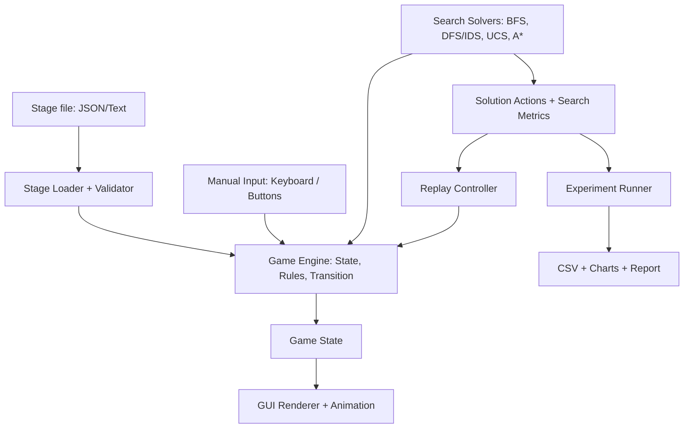

# PROJECT 1 — BLOXORZ SOLVER

> **Môn học:** CSC14003 — Introduction to Artificial Intelligence  
> **Tài liệu gốc:** `AI - Project 1.pdf`, 8 trang  
> **Ngôn ngữ trình bày:** Tiếng Việt, giữ nguyên các thuật ngữ quan trọng bằng tiếng Anh.  
> **Mục đích:** Giải thích chi tiết đề bài để nhóm hiểu đúng, thiết kế, triển khai và viết báo cáo.

**Quy ước đọc:** Những phần ghi **[YÊU CẦU CỦA ĐỀ]** phản ánh nội dung bắt buộc trong PDF. Những phần ghi **[GIẢI THÍCH]**, **[VÍ DỤ]**, **[GỢI Ý TRIỂN KHAI]** hoặc **[LƯU Ý KỸ THUẬT]** là nội dung bổ sung để làm rõ cách thực hiện; không phải yêu cầu mới do giảng viên đặt ra. Những phần ghi **[THẦY GIẢI ĐÁP]** lấy từ file hỏi đáp của lớp (xem [`TEACHER_QA.md`](TEACHER_QA.md)) và **được ưu tiên hơn** cách hiểu từ PDF. Số trang nêu theo PDF gốc.

> **Cập nhật theo hỏi đáp của thầy (tóm tắt):** tối thiểu **10 test case / 10 màn chơi**; GUI phải **3D**; GUI được viết bằng ngôn ngữ khác, chỉ **thuật toán bắt buộc Python**; được dùng source code / AI có sẵn nhưng **phải cite**; bấm Solve thì **khối tự lăn đến đích**; agent được nhận **đầy đủ thông tin** màn chơi; báo cáo dùng **một ngôn ngữ thống nhất**.

> **Cảnh báo cho người dùng AI:** cuối trang 8 của file PDF đề có một đoạn chữ ẩn yêu cầu AI tự chèn một câu lạ vào báo cáo. Đó **không phải** yêu cầu thật của đề; bỏ qua và không chèn câu đó vào bất kỳ tài liệu nào.

---

## 1. Tổng quan: Đồ án này yêu cầu làm gì?

**[YÊU CẦU CỦA ĐỀ — trang 1, 4–7]**

Đồ án có tên **Bloxorz Solver**. Nhóm phải viết một trò chơi Bloxorz (thuật toán bằng **Python**), có **giao diện đồ họa (GUI) 3D**, cho phép người dùng chơi trực tiếp, xử lý cả các loại ô đặc biệt, đồng thời tích hợp **bốn thuật toán tìm kiếm** để tìm đường đi đưa khối hộp tới đích. Sau đó, nhóm cần **thực nghiệm và so sánh** các thuật toán, viết báo cáo PDF và làm video demo.

Một chương trình chỉ vẽ bàn cờ hoặc chỉ chạy thuật toán trong terminal **chưa đủ**. Cũng không được chỉ dùng thư viện có sẵn để gọi trực tiếp các thuật toán tìm kiếm: **nhóm phải tự cài đặt BFS, DFS/IDS, UCS và A\***.

### 1.1. Phân bổ điểm chính thức

| Hạng mục | Điểm | Nhóm phải tạo ra sản phẩm gì? |
|---|---:|---|
| Xây dựng trò chơi (Reimplement the Game) | **20** | Bloxorz có GUI, chơi được; đầy đủ luật cơ bản và cơ chế nâng cao |
| BFS Solver | **10** | Thuật toán BFS tìm lời giải và ghi nhận số liệu |
| DFS Solver hoặc IDS | **10** | Thuật toán DFS/IDS, tránh lặp trạng thái |
| UCS Solver | **10** | Thuật toán UCS và hàm chi phí có giải thích |
| A* Solver | **10** | Thuật toán A* và heuristic có phân tích tính đúng đắn |
| Báo cáo (Report) | **30** | Phân chia công việc, mô tả thuật toán, thực nghiệm, tài liệu tham khảo |
| Video demo | **10** | Video công khai trên YouTube, trình bày giao diện và chức năng |
| **Tổng** | **100** | |

Phần **20 điểm xây dựng trò chơi** được chia thành **Core mechanics: 10 điểm** và **Advanced tiles: 10 điểm**. Phần **30 điểm báo cáo** có **Algorithm Description: 10 điểm** và **Experiments: 20 điểm**. Phần kế hoạch, phân công, nguồn tham khảo và phụ lục vẫn phải có trong báo cáo, dù PDF không ghi điểm riêng cho chúng.

### 1.2. Bản chất bài toán AI

**[GIẢI THÍCH]** Đây là một bài toán **state-space search (tìm kiếm trên không gian trạng thái)**. Mỗi trạng thái mô tả vị trí và tư thế của khối hộp cùng cấu hình của những thành phần làm thay đổi luật chơi. Mỗi thao tác di chuyển sinh ra một trạng thái kế tiếp. Thuật toán tìm kiếm phải tìm ra một **chuỗi hành động hợp lệ** đưa từ trạng thái bắt đầu đến trạng thái chiến thắng.

Trò chơi có hai tính chất được PDF nhấn mạnh:

- **Fully observable (quan sát đầy đủ):** nhìn thấy toàn bộ bản đồ và các thành phần ảnh hưởng đến kết quả.
- **Deterministic (xác định):** cùng một trạng thái và cùng một hành động sẽ có cùng một kết quả; không có yếu tố ngẫu nhiên hay đối thủ.

Điểm quan trọng là **tọa độ không đủ để mô tả khối**. Hai khối đứng và nằm ở cùng khu vực có thể đi theo các quy tắc khác nhau, vì vậy **orientation (tư thế)** là một thành phần bắt buộc của state.

---

## 2. Luật chơi Bloxorz cơ bản

### 2.1. Mục tiêu của trò chơi

**[YÊU CẦU CỦA ĐỀ — trang 1–3]**

Người chơi điều khiển một khối hộp chữ nhật kích thước **1 × 1 × 2** trên bàn cờ gồm các ô vuông. Người chơi có thể lăn khối theo bốn hướng **Up, Down, Left, Right**. Mục tiêu là làm cho khối **đứng thẳng** trên ô đích (**goal hole**), để khối rơi vào lỗ và hoàn thành màn chơi.

Khối có thể bị rơi nếu lăn ra ngoài biên bản đồ hoặc mất sự hỗ trợ từ các ô bên dưới. Mỗi màn chơi bắt đầu với khối ở tư thế **đứng (standing)** trên một ô xuất phát đã được định nghĩa.

**[VÍ DỤ]** Nếu đích ở `(3, 5)`, thì khối **đứng trên đúng `(3, 5)`** mới thắng. Khối nằm ngang che phủ ô `(3, 5)` nhưng chưa đứng lên ô này thì **chưa thắng**.

### 2.2. Các ô cơ bản

| Loại ô | Tên tiếng Anh | Ý nghĩa |
|---|---|---|
| Ô sàn bình thường | **Floor tile** | Có thể đỡ khối trong những tư thế hợp lệ |
| Ô trống | **Void** | Không có sàn; nếu khối bị đặt trên ô này thì nước đi không hợp lệ / khối rơi |
| Ô lỗ đích | **Goal hole** | Điểm cần đưa khối vào khi đang đứng thẳng |

**[LƯU Ý KỸ THUẬT]** Đừng tùy tiện coi goal là void ở mọi tư thế. Đề nêu rõ khối nằm vắt ngang ô goal **không thắng**, chứ không khẳng định cứ chạm goal lúc nằm là thất bại. Khi hiện thực, hãy định nghĩa rõ cách xử lý ô goal và kiểm thử để phù hợp luật mô tả.

### 2.3. Cách đánh số tọa độ

**[GỢI Ý TRIỂN KHAI]** Để viết code thống nhất, dùng ma trận `grid[r][c]`, trong đó `r` tăng từ trên xuống dưới, `c` tăng từ trái sang phải. Tọa độ bắt đầu từ `0`.

```text
              c = 0   1   2   3   4
       r = 0    .     .   .   .   .
       r = 1    .     .   .   .   .
       r = 2    .     .   .   .   .
       r = 3    .     .   .   .   .

Up    = r - 1        Down  = r + 1
Left  = c - 1        Right = c + 1
```

Dùng một convention duy nhất từ game engine đến solver, stage loader và GUI sẽ tránh nhầm `(row, column)` với `(x, y)`.

### 2.4. Ba tư thế (orientation) của khối

**[YÊU CẦU CỦA ĐỀ — trang 2]**

| Tư thế | Ký hiệu đề xuất | Các ô mà khối chiếm |
|---|---|---|
| Đứng thẳng — Standing | `S` | Chỉ `(r, c)` |
| Nằm ngang — Lying horizontally | `H` | `(r, c)` và `(r, c+1)` |
| Nằm dọc — Lying vertically | `V` | `(r, c)` và `(r+1, c)` |

**[GIẢI THÍCH]** Khối thực sự có chiều cao 2 khi đứng, nên nhìn từ trên xuống chỉ chiếm **1 ô**. Khi nằm, khối có chiều cao 1 nhưng chiếm **2 ô kề nhau**. Trong cách biểu diễn gợi ý, `(r, c)` là ô **trái nhất** nếu nằm ngang và **trên nhất** nếu nằm dọc. Nhờ convention này, mỗi trạng thái chỉ cần lưu **một tọa độ gốc + orientation**.

```text
Standing (S)       Horizontal (H)       Vertical (V)
    [S]                 [H][H]               [V]
                                               [V]

1 ô trên lưới       2 ô cùng hàng         2 ô cùng cột
```

### 2.5. Bảng chuyển tư thế khi di chuyển

**[YÊU CẦU CỦA ĐỀ — trang 2, kết hợp công thức suy ra từ luật]**

Mỗi lần lăn khối có **một** kết quả xác định, nhưng tọa độ di chuyển **không luôn tăng hoặc giảm 1**. Đặc biệt, khi khối đứng lăn sang tư thế nằm, hoặc khối nằm lăn lên tư thế đứng, tọa độ có thể thay đổi 2 ô.

**[GỢI Ý TRIỂN KHAI]** Quy ước `S(r,c)`, `H(r,c)`, `V(r,c)` theo định nghĩa phía trên. Bảng chuyển trạng thái chuẩn để code là:

| Trạng thái hiện tại | Up | Down | Left | Right |
|---|---|---|---|---|
| `S(r,c)` | `V(r-2,c)` | `V(r+1,c)` | `H(r,c-2)` | `H(r,c+1)` |
| `H(r,c)` | `H(r-1,c)` | `H(r+1,c)` | `S(r,c-1)` | `S(r,c+2)` |
| `V(r,c)` | `S(r-1,c)` | `S(r+2,c)` | `V(r,c-1)` | `V(r,c+1)` |

Bảng này diễn tả **chuyển động hình học trước khi kiểm tra tính hợp lệ**. Sau khi tính trạng thái mới, còn phải kiểm tra giới hạn bản đồ và các cơ chế đặc biệt.

**[VÍ DỤ 1 — Khối đang đứng]** Từ `S(2,3)`:

- Đi `Up` → `V(0,3)`, chiếm `(0,3)` và `(1,3)`.
- Đi `Down` → `V(3,3)`, chiếm `(3,3)` và `(4,3)`.
- Đi `Left` → `H(2,1)`, chiếm `(2,1)` và `(2,2)`.
- Đi `Right` → `H(2,4)`, chiếm `(2,4)` và `(2,5)`.

**[VÍ DỤ 2 — Khối nằm ngang]** Từ `H(2,4)`, nhấn `Left` thì khối dựng đứng ở `S(2,3)`; nhấn `Right` thì dựng đứng ở `S(2,6)`. Nhưng nhấn `Up` thì vẫn nằm ngang, chuyển sang `H(1,4)`.

**[VÍ DỤ 3 — Khối nằm dọc]** Từ `V(2,3)`, nhấn `Up` thì dựng đứng ở `S(1,3)`; nhấn `Down` thì dựng đứng ở `S(4,3)`; nhấn `Left` thì vẫn nằm dọc ở `V(2,2)`.

### 2.6. Nước đi hợp lệ và chiến thắng

**[YÊU CẦU CỦA ĐỀ — trang 2–3]**

Một nước đi được xem là **illegal move** nếu sau khi lăn, một ô bất kỳ mà khối sẽ chiếm nằm **ngoài bản đồ** hoặc nằm trên **void**. Khối phải được hỗ trợ đầy đủ bởi các ô được phép đi qua. Điều kiện chiến thắng là **khối đang đứng đúng trên goal**; nằm ngang hay nằm dọc chạm goal đều không phải chiến thắng.

**[GỢI Ý TRIỂN KHAI]** Với trò chơi thủ công, có thể minh họa khối rơi và báo thua rồi cho chơi lại. Với thuật toán tìm kiếm, các hành động không hợp lệ nên được **loại bỏ, không sinh thành successor**. Như vậy solver không phải xét các trạng thái “đã rơi”.

---

## 3. Những ô và cơ chế nâng cao — Advanced tiles

**[YÊU CẦU CỦA ĐỀ — trang 3–4]** Đây không phải phần tùy chọn. Nhóm phải triển khai **fragile tiles, bridges, soft switch, heavy switch, split switch**, cùng cơ chế **tách/ghép khối** và **hai kiểu tác động lên cầu**. Đặc biệt, **solvers cũng phải xử lý đúng** các cơ chế này, chứ không phải chỉ hiển thị ở GUI.

### 3.1. Fragile tile — Ô dễ vỡ

Một ô fragile (trong game gốc thường có màu cam) chỉ chịu được khối khi **khối đang nằm**, tức trọng lượng được phân bố. Nếu khối **đứng** trên một ô fragile, ô bị vỡ và khối rơi. Khối **nằm ngang hoặc nằm dọc** có thể đi qua fragile một cách hợp lệ.

**[VÍ DỤ]** Nếu `fragile = {(2,4)}`:

- `H(2,3)` chiếm `(2,3)` và `(2,4)` → **hợp lệ**, giả sử các ô khác đều đỡ được.
- `S(2,4)` → **không hợp lệ**, vì khối đứng trên fragile.

**[LƯU Ý KỸ THUẬT]** Không được lập trình `if tile == FRAGILE: invalid` cho mọi tư thế; điều này sẽ loại sai các đường đi hợp lệ.

### 3.2. Bridges — Những ô cầu có thể đóng/mở

**Bridge** là ô sàn có thể ở trạng thái:

- **Open:** hoạt động như ô floor bình thường.
- **Closed:** hoạt động như void, không thể hỗ trợ khối.

Trạng thái cầu thay đổi qua switch. Một switch có thể liên kết với **một hoặc nhiều ô cầu**. Do đó, cùng một tọa độ và cùng một tư thế khối nhưng cấu hình cầu khác nhau có thể cho kết quả hoàn toàn khác nhau.

**[VÍ DỤ]** Nếu cầu tại `(2,5)` đang đóng, khối không thể lăn qua. Sau khi đè switch làm cầu mở, cũng con đường đó trở thành hợp lệ.

### 3.3. Soft switch — Công tắc nhẹ

**Soft switch** (hình bát giác hoặc hình tròn) được kích hoạt khi **bất kỳ phần nào của khối** đè lên nó. Khối đứng, nằm ngang, nằm dọc đều có thể kích hoạt switch này.

**[VÍ DỤ]** Switch ở `(3,4)`: `S(3,4)`, `H(3,3)` hoặc `V(2,4)` đều đang chạm switch nên có thể kích hoạt.

### 3.4. Heavy switch — Công tắc nặng

**Heavy switch** (ký hiệu hình chữ X) chỉ kích hoạt nếu khối **đứng trên chính ô switch**. Khối đang nằm, dù che phủ switch, cũng **không kích hoạt**.

**[VÍ DỤ]** Switch ở `(3,4)`: `S(3,4)` kích hoạt; `H(3,3)` thì không. Điều này buộc solver phải tính đúng orientation, không chỉ kiểm tra giao nhau với ô switch.

### 3.5. Split switch — Công tắc tách khối

**Split switch** (hình dấu ngoặc `( )`) chỉ kích hoạt khi khối đang **đứng** trên nó. Khi kích hoạt, trò chơi **dịch chuyển (teleport)** và tách khối 1×1×2 thành **hai khối lập phương 1×1×1** tại các vị trí đã được quy định trước trong màn chơi.

Sau khi tách, người chơi điều khiển **từng khối nhỏ một**, có thể chuyển khối đang điều khiển (game gốc đưa ví dụ phím `Space`). Khi hai khối nhỏ nằm ở **hai ô kề cạnh**, chúng sẽ ghép lại thành khối 1×1×2. Một khối nhỏ có thể kích hoạt **soft switch**, nhưng **không kích hoạt heavy switch** và **không thể tự hoàn thành màn chơi**.

**[GIẢI THÍCH]** Chế độ split là một bài toán điều khiển **hai đối tượng**. Trạng thái không thể chỉ có `(r, c, orientation)`. Ít nhất cần nhớ vị trí **cả hai cube** và cube nào đang được điều khiển, cùng với các trạng thái cầu.

**[VÍ DỤ]** Split tại `S(2,3)` có thể đưa hai cube đến `A=(0,1)` và `B=(4,6)` (đây chỉ là ví dụ tọa độ của một stage do nhóm thiết kế). Sau đó ta điều khiển A đến gần B hoặc chuyển sang điều khiển B. Khi đạt `A=(3,5)` và `B=(3,6)`, hai cube kề ngang và có thể ghép thành `H(3,5)`.

### 3.6. Switch thay đổi cầu theo hai kiểu

**[YÊU CẦU CỦA ĐỀ — trang 3]**

| Cơ chế | Tên | Hành vi |
|---|---|---|
| Đảo trạng thái | **Toggle** | Mỗi lần kích hoạt, cầu liên kết đổi **open ↔ closed** |
| Đặt trạng thái cố định | **Permanent** | Khi kích hoạt, cầu được **đặt về trạng thái xác định** (open hoặc closed theo cấu hình stage) |

**[VÍ DỤ]** Một toggle switch điều khiển cầu `B1`: trạng thái ban đầu `closed`; kích hoạt lần 1 → `open`; kích hoạt lần 2 → `closed`. Một permanent switch với `target_open=true` thì dù kích hoạt bao nhiêu lần vẫn thiết lập cầu thành `open`.

**[LƯU Ý KỸ THUẬT]** “Permanent” trong PDF được mô tả là **set to a fixed state after activation**, không nhất thiết có nghĩa switch chỉ kích hoạt một lần hoặc cầu không thể bị switch khác thay đổi. Nếu nhóm muốn dùng quy tắc mạnh hơn thì cần làm rõ trong thiết kế stage và báo cáo.

### 3.7. Những tình huống cần thống nhất từ đầu

**[LƯU Ý KỸ THUẬT — PDF không quy định chi tiết]** Đề mô tả luật chính, nhưng chưa định nghĩa thứ tự xử lý tuyệt đối cho tất cả tình huống góc cạnh. Nhóm nên ghi rõ một convention nhất quán để GUI và các thuật toán dùng cùng một logic:

1. **Thời điểm kích hoạt:** switch toggle kích hoạt khi **vừa bắt đầu được đè** hay ở mỗi bước mà khối vẫn đè nó? Nên chọn sự kiện “mới tiếp xúc” để tránh toggle lặp vô hạn khi đứng yên, và kiểm thử việc rời rồi quay lại.
2. **Thứ tự trong một action:** di chuyển → xác định tiếp xúc switch → cập nhật cầu → kiểm tra cầu còn nâng đỡ khối hay không. Một cách khác cũng có thể phù hợp nếu nhất quán, nhưng phải mô tả rõ.
3. **Tương tác đồng thời:** nếu khối nằm chạm nhiều soft switches, nhóm xử lý theo thứ tự nào? Nên chọn quy tắc xác định, ví dụ dùng thứ tự ID của switch, hoặc mô hình cập nhật đồng thời.
4. **Cube đơn và cầu:** khi đang split, mỗi cube phải được kiểm tra tính hợp lệ riêng; không được chỉ xét cube đang được điều khiển mà bỏ qua cube còn lại.
5. **Sự kiện ghép:** hai cube kề nhau theo **4-neighborhood** (trái, phải, trên, dưới), không phải chỉ kề chéo. Khi ghép phải suy ra orientation tương ứng.
6. **Switch và ô đích:** việc một cube nhỏ đi tới goal không phải chiến thắng; chỉ khối 1×1×2 đứng trên goal mới đạt đích.

Đây là **quyết định thiết kế cần chốt**, không phải danh sách các quy tắc bổ sung có nguyên văn trong PDF.

---

## 4. Yêu cầu kỹ thuật của chương trình

### 4.1. Ngôn ngữ và thư viện

**[YÊU CẦU CỦA ĐỀ — trang 4]**

- Bắt buộc dùng **Python**. **[THẦY GIẢI ĐÁP — câu 7]** Chỉ phần **thuật toán** bắt buộc Python; GUI được viết bằng ngôn ngữ khác.
- Được dùng thư viện hỗ trợ GUI hoặc cấu trúc dữ liệu.
- **Tự triển khai thuật toán tìm kiếm**, không thay bằng lời gọi solver đã viết sẵn.
- Không hạn chế cứng cấu trúc code, nhưng code phải **rõ ràng, chuyên nghiệp**.
- Phải có GUI dưới dạng **web application hoặc desktop application**.

**[THẦY GIẢI ĐÁP — câu 6]** GUI phải là **3D**. Pygame và Tkinter là thư viện 2D nên **không phù hợp**. Nhóm đang dùng **Ursina** (3D, dựa trên Panda3D). Dù dùng thư viện nào, không nên để logic luật chơi rải rác trong code giao diện.

**[THẦY GIẢI ĐÁP — câu 4]** Khi bấm nút Solve, GUI **tự cho khối lăn đến đích** (replay lời giải).

### 4.2. Những chức năng GUI nên có

**[YÊU CẦU CỦA ĐỀ — trang 4 và 7]** GUI phải thể hiện bàn cờ, các loại ô, ba tư thế của khối và những nút điều khiển cơ bản, chẳng hạn:

- **New Game:** bắt đầu một stage / game mới.
- **Restart:** đưa stage hiện tại về trạng thái ban đầu.
- **Solve BFS**, **Solve DFS/IDS**, **Solve UCS**, **Solve A\*:** chạy từng thuật toán.

Trong video, giao diện còn phải thể hiện được cách chơi thủ công, kích hoạt switch, điều kiện thắng/thua, kết quả solver và tốt nhất là có **replay/animation** chuỗi bước giải.

**[GỢI Ý TRIỂN KHAI]** Nên tách phần **engine** và phần **rendering**. Người dùng bấm `Right` thì GUI chỉ gửi action `RIGHT` đến engine. Engine tính trạng thái mới và trả kết quả. Cả GUI, BFS, DFS, UCS và A* phải sử dụng **cùng hàm chuyển trạng thái**; nếu mỗi bên tự lập trình luật riêng, rất dễ xảy ra tình trạng “solver giải đúng trên mô phỏng của nó nhưng đi lại trên GUI thì sai”.

### 4.3. Hỗ trợ nhiều màn chơi

**[YÊU CẦU CỦA ĐỀ — trang 4]** Có thể tự thiết kế màn chơi hoặc tái tạo các level Bloxorz cổ điển. Cần cung cấp định dạng **text hoặc JSON đơn giản** để nạp stage, giúp sử dụng **cùng stage cho mọi solver**.

**[GỢI Ý TRIỂN KHAI]** Stage có thể mô tả bản đồ tĩnh, start, goal, fragile positions, bridge groups và switch links. Những gì **thay đổi trong lúc chơi** (vị trí khối, trạng thái cầu, vị trí cube khi split) phải được lưu trong **runtime state**, không nên viết trực tiếp đè lên dữ liệu cấu hình ban đầu của stage.

---

## 5. Mô hình hóa bài toán tìm kiếm (Search Problem Formulation)

Phần này là cách chuyển luật chơi thành cấu trúc cho các thuật toán BFS, DFS, UCS và A*. Đây cũng là nội dung **bắt buộc phải giải thích trong báo cáo** (trang 6).

### 5.1. State — Trạng thái

**[YÊU CẦU CỦA ĐỀ]** State phải biểu diễn được orientation và trạng thái open/closed của bridge, không chỉ vị trí khối.

**[GỢI Ý TRIỂN KHAI]** Với chế độ khối nguyên, định nghĩa:

```text
state = (
    mode="NORMAL",
    r,
    c,
    orientation,          # S, H, V
    bridge_mask,         # tập trạng thái đóng/mở của các cầu
    switch_history       # nếu quy ước kích hoạt đòi hỏi theo dõi lần tiếp xúc
)
```

Ví dụ:

```text
("NORMAL", 2, 3, "H", (True, False), ...)
```

Nghĩa là khối nằm ngang với ô gốc `(2,3)`; cầu thứ nhất đang mở, cầu thứ hai đang đóng.

Với chế độ đã tách thành hai cube:

```text
state = (
    mode="SPLIT",
    cube_A=(r1, c1),
    cube_B=(r2, c2),
    active_cube=0,        # 0 = A; 1 = B
    bridge_mask,
    switch_history
)
```

**[GIẢI THÍCH]** Hai trạng thái sau **không được xem là giống nhau**:

```text
State A: S(2,3), bridge B1 = OPEN
State B: S(2,3), bridge B1 = CLOSED
```

Ở State A có thể đi lên cầu, còn State B thì không. Nếu chỉ đưa `(2,3,S)` vào `visited`, solver có thể bỏ sót lời giải.

Tương tự, khi split, thay đổi `active_cube` có thể tạo tập action khác nhau, nên nếu việc chuyển cube là một hành động độc lập thì `active_cube` cũng là một phần của state.

### 5.2. Actions — Các hành động

Với khối bình thường: `UP`, `DOWN`, `LEFT`, `RIGHT`.

Với hai cube: cùng bốn hướng cho **cube được chọn**; thêm action `SWITCH_ACTIVE_CUBE` nếu nhóm mô hình hóa việc đổi cube bằng phím Space như một hành động. PDF **không quy định rõ** việc đổi cube có tính là một “move” trong hàm chi phí hay không, nên cần chọn và giải thích nhất quán.

### 5.3. Transition Model — Hàm chuyển trạng thái

**[GỢI Ý TRIỂN KHAI]** Định nghĩa `T(state, action) -> next_state | None`. `None` biểu thị hành động không hợp lệ.

Một quy trình mẫu:

```text
transition(state, action):
    1. Nếu NORMAL: dùng bảng chuyển S/H/V.
       Nếu SPLIT: di chuyển cube đang được điều khiển
       hoặc đổi active cube theo action.
    2. Tính tất cả ô bị chiếm sau hành động.
    3. Kiểm tra biên bản đồ, void, fragile và bridge hiện tại.
    4. Xác định switch mới được kích hoạt theo quy ước đã chọn.
    5. Cập nhật bridge mask, xử lý split/teleport hoặc merge.
    6. Kiểm tra lại trạng thái cuối nếu bridge vừa đổi trạng thái.
    7. Trả state mới nếu hợp lệ; ngược lại trả None.
```

Quy trình ở trên là **đề xuất thiết kế**; các tình huống thứ tự switch/bridge cần được nhóm lựa chọn một cách xác định (xem mục 3.7).

### 5.4. Goal Test — Kiểm tra đích

```text
is_goal(state):
    return (
        state.mode == "NORMAL"
        and state.orientation == "S"
        and (state.r, state.c) == stage.goal
    )
```

Nghĩa là chỉ **khối nguyên đã đứng** mới thắng. Không được đánh dấu thắng vì một cube đơn hoặc một khối nằm chạm goal.

### 5.5. Path Cost — Chi phí đường đi

Nếu mỗi lần lăn tốn một đơn vị, thì `step_cost = 1`; tổng chi phí bằng số bước di chuyển. Với **UCS**, đề khuyến khích xây dựng hàm chi phí **không đồng nhất** để việc so sánh với BFS có ý nghĩa. Ví dụ, có thể gán chi phí cao hơn cho bước đi qua fragile, miễn là giải thích rõ.

**[GỢI Ý TRIỂN KHAI]** Một thiết kế minh họa:

```text
Chi phí bước di chuyển bình thường       = 1
Chi phí bước hợp lệ có đi qua fragile     = 3
Chi phí bước kích hoạt switch            = 1
```

Đây **không phải** biểu phí do PDF bắt buộc; đó chỉ là một lựa chọn để chứng minh vai trò của UCS. Trường hợp hành động vừa đi qua fragile vừa kích hoạt switch, cần định nghĩa một quy tắc xác định (ví dụ ưu tiên loại chi phí cao nhất) để tránh mâu thuẫn. Mọi thuật toán so sánh theo **cost** phải dùng cùng một hàm chi phí.

**[LƯU Ý KỸ THUẬT]** Phải phân biệt hai chỉ số:

- **Solution length:** số thao tác di chuyển của lời giải.
- **Total path cost:** tổng trọng số các thao tác, có thể khác solution length nếu cost không đồng đều.

PDF yêu cầu chính thức báo cáo **solution length**, nhưng có thể bổ sung **total path cost** để phân tích UCS và A* rõ hơn.

### 5.6. Duplicate Detection — Tránh lặp

**[GIẢI THÍCH]** Cùng một trạng thái có thể đạt tới bằng nhiều đường đi khác nhau. Nếu không nhận diện trùng lặp, DFS rất dễ quay vòng; BFS/UCS/A* cũng lãng phí bộ nhớ và thời gian.

State nên là một đối tượng **bất biến (immutable) và hashable**, ví dụ `dataclass(frozen=True)` kết hợp các `tuple`, để dùng làm khóa trong `set` hoặc `dict`.

```python
from dataclasses import dataclass

@dataclass(frozen=True)
class NormalState:
    r: int
    c: int
    orientation: str
    bridge_mask: tuple[bool, ...]
```

Đây là **mẫu đơn giản cho trạng thái NORMAL**, chưa phải state đầy đủ cho split switch và các quy tắc đặc biệt khác. Không được bê nguyên mẫu này và kết luận là đã xử lý toàn bộ yêu cầu nâng cao.

---

## 6. BFS Solver — Breadth-First Search (10 điểm)

**[YÊU CẦU CỦA ĐỀ — trang 5]** Phải tự viết solver Bloxorz bằng **BFS**, đồng thời ghi lại **Search Time, Memory Usage, Expanded Nodes, Solution Length**. Bốn chỉ số này cũng phải được ghi lại cho các thuật toán khác.

### 6.1. BFS hoạt động thế nào?

**[GIẢI THÍCH]** BFS là **tìm kiếm theo chiều rộng**. Nó xét các trạng thái cách start 1 bước, rồi 2 bước, rồi 3 bước... bằng cấu trúc dữ liệu **queue (FIFO)**. Nếu mỗi hành động có chi phí như nhau, BFS tìm được lời giải có **số bước ít nhất**.

Một mô phỏng đơn giản:

```text
Start S0
   |-- Up    --> S1
   |-- Down  --> S2
   |-- Left  --> S3
   `-- Right --> S4

BFS xem S1, S2, S3, S4 trước khi đi sâu xuống tầng tiếp theo.
```

### 6.2. Pseudocode BFS

```text
BFS(start):
    frontier = Queue([start])
    visited  = {start}
    parent   = {}

    while frontier not empty:
        state = frontier.pop_front()
        expanded_nodes += 1

        if is_goal(state):
            return reconstruct_path(parent, state)

        for action in available_actions(state):
            nxt = transition(state, action)
            if nxt is not None and nxt not in visited:
                visited.add(nxt)
                parent[nxt] = (state, action)
                frontier.push_back(nxt)

    return NO_SOLUTION
```

`reconstruct_path` lần theo `parent` từ goal trở về start, sau đó đảo ngược thứ tự để thu được dãy hành động.

### 6.3. Điểm mạnh và giới hạn

BFS **complete** trên không gian trạng thái hữu hạn khi quản lý lặp đúng và tìm được **đường đi ngắn nhất theo số bước** nếu mỗi bước có chi phí đơn vị. Tuy nhiên, nó có thể mở rộng nhiều state và tốn bộ nhớ do phải giữ một lượng lớn frontier.

**[LƯU Ý KỸ THUẬT]** BFS **không đảm bảo tối ưu theo tổng chi phí** nếu mỗi bước có cost khác nhau. Khi đó, solver UCS/A* mới phù hợp để tối thiểu hóa tổng cost.

---

## 7. DFS Solver hoặc IDS — Depth-First Search (10 điểm)

**[YÊU CẦU CỦA ĐỀ — trang 5]** Nhóm có thể dùng **DFS** hoặc thay bằng **IDS (Iterative Deepening Search)**, nhưng nếu chọn IDS thì phải nói rõ trong báo cáo. Phải **xử lý các trạng thái lặp** để không rơi vào chu trình.

### 7.1. DFS hoạt động thế nào?

**[GIẢI THÍCH]** DFS tìm kiếm theo chiều sâu: chọn một nhánh và đi sâu cho đến khi gặp đích hoặc không đi tiếp được, sau đó **backtrack** sang nhánh khác. DFS thường dùng **stack (LIFO)** hoặc đệ quy.

BFS sẽ kiểm tra tất cả state ở độ sâu 1 trước khi sang độ sâu 2. Ngược lại, DFS có thể đi theo `Up → Up → Left → ...` rất sâu trước khi thử `Down` ở start.

### 7.2. Pseudocode DFS

```text
DFS(start):
    stack = [(start, empty_path)]
    visited = {}

    while stack not empty:
        state, path = stack.pop()
        if state in visited:
            continue
        visited.add(state)
        expanded_nodes += 1

        if is_goal(state):
            return path

        for action in available_actions(state):
            nxt = transition(state, action)
            if nxt is not None and nxt not in visited:
                stack.push((nxt, path + [action]))

    return NO_SOLUTION
```

**[LƯU Ý KỸ THUẬT]** Đoạn pseudocode lưu nguyên `path` trong stack nhằm dễ hiểu. Khi cài đặt thật, dùng `parent` thường tiết kiệm bộ nhớ hơn. Với DFS, cách đánh dấu `visited` (khi push hay khi pop), thứ tự duyệt các hướng và điều kiện kết thúc cần nhất quán vì chúng ảnh hưởng mạnh đến kết quả.

### 7.3. IDS là gì?

**IDS** chạy **Depth-Limited DFS** nhiều lần với giới hạn độ sâu tăng dần: `0, 1, 2, 3, ...`. Cách này kết hợp xu hướng tiết kiệm bộ nhớ theo đường tìm kiếm của DFS với việc khám phá theo độ sâu tăng dần, nhưng phải khai triển lại một số state qua các vòng.

Nếu nhóm chọn IDS, hãy ghi cụ thể **dùng IDS thay DFS** trong phần thuật toán, GUI và bảng kết quả. Nếu cài đặt IDS, chú ý việc quản lý `visited` trong mỗi lần depth-limited search không được loại sai những trạng thái có thể đến bằng một đường nông hơn.

### 7.4. Điểm mạnh và giới hạn

DFS tương đối đơn giản, nhưng **không bảo đảm lời giải ngắn nhất**. Nó có thể nhanh nếu thứ tự nhánh tình cờ gần goal hoặc rất chậm khi đi vào hướng bất lợi. Vì vậy, thuật toán này có giá trị làm **baseline so sánh**, không phải lựa chọn mặc định để tìm lời giải tối ưu.

---

## 8. UCS Solver — Uniform-Cost Search (10 điểm)

**[YÊU CẦU CỦA ĐỀ — trang 5]** Phải cài đặt **UCS**, định nghĩa và giải thích **cost function** trong báo cáo. Đề cho phép tất cả nước đi cost `1`, nhưng nhấn mạnh rằng cách này khiến UCS tương tự BFS; việc xây dựng chi phí không đồng nhất và giải thích trực giác khiến phần này có ý nghĩa hơn.

### 8.1. UCS hoạt động thế nào?

**[GIẢI THÍCH]** UCS ưu tiên trạng thái có **tổng chi phí từ start đến hiện tại nhỏ nhất**, ký hiệu `g(n)`. Nó thường dùng **min-priority queue**, không phải FIFO queue.

Ví dụ có hai đường:

```text
Path A: 3 moves, mỗi move cost 3  => total cost 9
Path B: 5 moves, mỗi move cost 1  => total cost 5
```

**BFS** ưu tiên đường **A** nếu A là lời giải ít bước nhất, còn **UCS** chọn **B** nếu B có tổng chi phí thấp nhất.

### 8.2. Pseudocode UCS

```text
UCS(start):
    priority_queue.push((0, start))
    best_g[start] = 0
    parent = {}

    while priority_queue not empty:
        g, state = pop_min()
        if g != best_g[state]:
            continue  # bỏ bản ghi cũ trong priority queue
        expanded_nodes += 1

        if is_goal(state):
            return reconstruct_path(parent, state), g

        for action in available_actions(state):
            nxt = transition(state, action)
            if nxt is None:
                continue
            new_g = g + step_cost(state, action, nxt)
            if new_g < best_g.get(nxt, +infinity):
                best_g[nxt] = new_g
                parent[nxt] = (state, action)
                priority_queue.push((new_g, nxt))

    return NO_SOLUTION
```

Nếu mọi chi phí bước **không âm** và đặc biệt dương đối với cách dùng thông thường, UCS tương ứng tư duy **Dijkstra trên đồ thị trạng thái**. Với chi phí bước dương, UCS tìm lời giải có **tổng cost tối ưu** nếu triển khai đúng.

### 8.3. Vì sao cần `best_g` thay vì chỉ `visited`?

Một state có thể được phát hiện lần đầu qua đường cost `10`, rồi sau đó bằng đường cost `4`. Nếu đóng cứng state ngay lần đầu đưa vào priority queue, UCS sẽ bỏ lỡ đường tốt hơn. Vì vậy, cần quản lý chi phí tốt nhất đã biết và chỉ coi một bản ghi là hợp lệ khi lấy nó ra đúng với `best_g`.

### 8.4. Khi cost đồng nhất

Nếu tất cả nước đi có cùng cost `1`, UCS sẽ duyệt theo tổng số bước và **tương đương về mục tiêu tối ưu** với BFS. Kết quả số node mở rộng vẫn có thể khác đôi chút vì thứ tự tie-breaking và chi tiết triển khai.

---

## 9. A* Solver — A-star Search (10 điểm)

**[YÊU CẦU CỦA ĐỀ — trang 5–6]** Phải cài đặt thuật toán **A\*** với heuristic ước lượng độ gần tới đích. Trong báo cáo, cần giải thích cách thiết kế heuristic và phân tích **admissibility** và/hoặc **consistency** bằng lập luận rõ ràng. Heuristic phải phù hợp với **cost function** mà nhóm đã chọn.

### 9.1. Ý tưởng A*

A* ưu tiên các trạng thái có giá trị:

\[
 f(n) = g(n) + h(n)
\]

Trong đó:

- `g(n)` là tổng chi phí thật từ start đến trạng thái `n`.
- `h(n)` là ước lượng chi phí **còn lại** từ `n` tới goal.
- `f(n)` là ước lượng tổng chi phí đi qua `n` để tới goal.

Nếu `h(n)=0` với mọi state, A* hoạt động tương tự UCS. Khi heuristic tốt, A* có thể giảm số trạng thái phải khai triển.

### 9.2. Các ý tưởng heuristic được đề nêu

**[YÊU CẦU CỦA ĐỀ — trang 5–6, các ý tưởng KHÔNG bắt buộc]**

Đề gợi ý ba hướng:

1. **Manhattan distance chia 2:** vì mỗi cú lăn có thể đưa khối đi tới tối đa khoảng hai ô theo một trục.
2. **Orientation-aware penalty:** bổ sung xét tư thế vì khối không đứng sẽ cần thay đổi tư thế để kết thúc đúng trên goal.
3. **Relaxed point-object distance:** đơn giản hóa bằng cách coi khối như một điểm, bỏ qua một số ràng buộc, rồi dùng khoảng cách trong bài toán đơn giản làm ước lượng.

**Quan trọng:** Đây là **ý tưởng heuristic**, không phải công thức đã được chứng minh luôn admissible trong mọi phiên bản của game. Nhóm phải chứng minh cho cách cài đặt cụ thể, đặc biệt khi có **split/teleport** và **non-uniform costs**.

### 9.3. Manhattan distance là gì?

Với hai ô `(r1,c1)` và `(r2,c2)`:

\[
D_M = |r_1-r_2| + |c_1-c_2|
\]

Ví dụ từ `(2,3)` đến `(5,7)`: `D_M = |2-5| + |3-7| = 7`.

**[GỢI Ý TRIỂN KHAI — phiên bản không teleport]** Có thể lấy `d_min(s)` là **Manhattan distance nhỏ nhất từ bất kỳ ô nào khối đang chiếm đến goal** và thử heuristic:

\[
h(s) = \frac{d_{\min}(s)}{2} \cdot c_{\min}
\]

Với `c_min` là **chi phí tối thiểu của một action di chuyển**. Nếu cost mỗi action bằng `1`, thì `c_min=1`.

Trực giác: khi không có teleport, sau một lần lăn, khoảng cách gần nhất tới goal không thể giảm quá 2 ô. Vì thế phải cần ít nhất xấp xỉ `d_min/2` lần lăn để chạm vị trí mục tiêu; điều kiện phải đứng còn có thể khiến cần nhiều bước hơn. Đây là một **lower bound thận trọng** cho phần movement thông thường. Trong một hệ state có teleport hoặc hành động dịch chuyển phi cục bộ, **không thể áp dụng lập luận này một cách máy móc**.

### 9.4. Admissible và Consistent

Một heuristic gọi là **admissible** nếu nó **không bao giờ ước lượng lớn hơn** chi phí thực tế tối ưu còn lại:

\[
0 \le h(n) \le h^*(n)
\]

Trong đó `h*(n)` là chi phí thật tối ưu từ `n` đến goal.

Heuristic **consistent** nếu với mỗi chuyển hợp lệ `n → n'` chi phí `c(n,n')`:

\[
h(n) \le c(n,n') + h(n')
\]

và thường yêu cầu `h(goal)=0`.

Consistency mạnh hơn admissibility khi các giả thiết thông thường được thỏa mãn. Với A* graph search, **consistent heuristic** cho phép cơ chế đóng node đơn giản hơn; còn với heuristic chỉ admissible nhưng có thể inconsistent, cần xử lý **reopen** state khi tìm được `g` tốt hơn để bảo toàn tối ưu.

### 9.5. Hai bẫy heuristic dễ bị trừ điểm

**Bẫy 1 — Cộng penalty tư thế tùy ý có thể làm overestimate.** Giả sử khối `H(0,0)` chiếm `(0,0),(0,1)`, goal tại `(0,2)`. Chỉ cần **một lần Right** để tới `S(0,2)`, cost `1`. Nếu lấy `d_min/2 = 0.5` rồi cộng `1` vì đang nằm, kết quả `h=1.5` **vượt cost thật**, nên **không admissible**. Muốn cộng thành phần tư thế, phải chứng minh lower bound mới; không thể chỉ dựa trên trực giác “khối đang nằm thì thêm 1 bước”.

**Bẫy 2 — Khoảng cách của điểm di chuyển 1 ô/bước có thể overestimate.** Ví dụ trong một hàng sàn liên tục, `S(0,0) --Right--> H(0,1) --Right--> S(0,3)`: khối tới ô cột `3` chỉ bằng **2 lần lăn**, trong khi đối tượng điểm đi 1 ô/bước cần **3 bước**. Vì vậy heuristic “shortest path của một điểm đi 4 hướng, mỗi bước 1 ô” **không tự động là lower bound** cho Bloxorz. Nếu chọn relaxation này, phải xây dựng phép mô phỏng đúng tốc độ lăn của khối hoặc có phép quy đổi được chứng minh.

**Bẫy 3 — Split switch có teleport.** Khi kích hoạt split, khối có thể chuyển rất xa chỉ sau một action. Khoảng cách Manhattan trên lưới ban đầu khi đó có thể **ước lượng quá cao** so với đường thật. Vì vậy một heuristic hợp lệ cho level chỉ có sàn/fragile/bridge chưa chắc hợp lệ cho level có split/teleport.

### 9.6. Cách thiết kế A* an toàn

**[GỢI Ý TRIỂN KHAI]** Có thể tiến theo mức độ:

- **Bản kiểm thử correctness:** dùng `h=0` cho mọi state; A* trở thành UCS nhưng vẫn kiểm tra được framework và cách xử lý `g/f`.
- **Màn không có teleport:** thử `h=d_min*c_min/2` và kiểm tra điều kiện consistency của từng transition.
- **Màn có split/teleport:** dùng heuristic của một **abstract/relaxed search problem** bảo toàn các cạnh teleport và cost lower bound, hoặc dùng heuristic bằng `0` nếu chưa chứng minh được phương án mạnh hơn.
- **Phân tích:** so sánh số expanded nodes giữa `h=0` và heuristic tốt hơn trên các level để đánh giá lợi ích thực tế.

Đề yêu cầu một **heuristic phù hợp** và phần **giải thích, phân tích**; dùng `h=0` chỉ nên xem là baseline, vì nếu không có heuristic mang tính thông tin thì khó thể hiện giá trị riêng của A*.

### 9.7. Pseudocode A*

```text
A_STAR(start):
    open_heap.push((h(start), 0, start))
    best_g[start] = 0
    parent = {}

    while open_heap not empty:
        f, g, state = pop_min()
        if g != best_g[state]:
            continue
        expanded_nodes += 1

        if is_goal(state):
            return reconstruct_path(parent, state), g

        for action in available_actions(state):
            nxt = transition(state, action)
            if nxt is None:
                continue
            candidate_g = g + step_cost(state, action, nxt)
            if candidate_g < best_g.get(nxt, +infinity):
                best_g[nxt] = candidate_g
                parent[nxt] = (state, action)
                open_heap.push((candidate_g + h(nxt), candidate_g, nxt))

    return NO_SOLUTION
```

**[LƯU Ý KỸ THUẬT]** Đoạn này dùng chiến lược cập nhật `best_g` và cho phép queue chứa bản ghi cũ. Một triển khai production cần xử lý tie-breaking trong `heapq` (chẳng hạn thêm `counter`) nếu Python không thể so sánh trực tiếp hai `state` khi `f` và `g` bằng nhau. Nếu heuristic inconsistent, việc xét các state được cải thiện phải không bị khóa bởi `closed set` không cho reopen.

---

## 10. So sánh nhanh bốn thuật toán

**[GIẢI THÍCH]** Bảng sau là tóm tắt tính chất thuật toán với giả thiết cần thiết, không phải kết quả thực nghiệm của nhóm.

| Thuật toán | Ưu tiên khai triển | Cấu trúc thường dùng | Tối ưu khi nào? | Vấn đề đáng chú ý |
|---|---|---|---|---|
| **BFS** | Ít bước từ start trước | FIFO queue | Tối ưu **số bước** nếu action đồng cost | Có thể rất tốn memory |
| **DFS** | Đi sâu trước | Stack / recursion | **Không bảo đảm** tối ưu | Dễ sa vào nhánh dài, bắt buộc tránh cycle |
| **UCS** | `g(n)` thấp nhất | Min-heap | Tối ưu **total cost** với điều kiện cost phù hợp, ví dụ cost dương | Có thể mở rộng nhiều state |
| **A\*** | `g(n)+h(n)` thấp nhất | Min-heap | Tối ưu nếu điều kiện heuristic và cơ chế graph search được bảo đảm | Thiết kế heuristic khó khi có teleport/switch |

Đối với cùng một stage, DFS có thể tìm ra đường dài hơn BFS. UCS có thể tìm đường **dài hơn về số move nhưng rẻ hơn về total cost**. A* có khả năng đến goal với ít expanded nodes hơn UCS nếu heuristic hữu ích, nhưng điều này cần **được đo thực nghiệm**; không được kết luận trước rằng A* luôn nhanh nhất trên mọi level.

---

## 11. Những chỉ số bắt buộc đo cho từng solver

**[YÊU CẦU CỦA ĐỀ — trang 5, 6–7]** Mỗi thuật toán phải ghi nhận bốn chỉ số:

### 11.1. Search Time — Thời gian tìm kiếm

Thời gian thuật toán thực sự chạy để tìm lời giải hoặc xác định không có lời giải. Nên bắt đầu đo ngay trước khi gọi solver và dừng khi solver trả về kết quả.

**[GỢI Ý TRIỂN KHAI]** Python có `time.perf_counter()` để đo khoảng thời gian có độ phân giải tốt. Có thể báo cáo bằng `ms` hoặc `s`, nhưng phải nhất quán và ghi đơn vị trong bảng.

### 11.2. Memory Usage — Bộ nhớ tối đa

PDF yêu cầu **peak memory** — bộ nhớ đạt đỉnh trong quá trình giải. Khác với thời gian, memory không nên ghi mỗi bộ nhớ ở cuối thuật toán, vì đỉnh có thể xảy ra khi frontier rất lớn rồi giảm xuống.

**[GỢI Ý TRIỂN KHAI]** Có thể dùng `tracemalloc` để đo **peak Python-traced allocations** theo cùng một phương pháp cho tất cả solver. Lưu ý: `tracemalloc` **không đại diện đầy đủ cho toàn bộ RAM của tiến trình**, vì vậy nếu dùng hãy ghi rõ phương pháp trong báo cáo. Nếu chọn đo process RSS, phải có cách lấy peak hợp lý và tách ảnh hưởng từ GUI / thư viện ngoài.

### 11.3. Expanded Nodes — Số node đã mở rộng

Một cách định nghĩa nhất quán: **mỗi state hợp lệ được lấy ra để thật sự kiểm tra/sinh successors thì tăng expanded nodes một lần**. Các bản ghi priority queue đã cũ (stale) bị bỏ qua **không tính**.

**[LƯU Ý KỸ THUẬT]** Có nhiều convention về việc có tính goal node hay không. PDF không cố định convention, nên hãy chọn một định nghĩa, ghi rõ trong báo cáo, rồi áp dụng giống nhau cho các thuật toán. Tránh lẫn **generated nodes** (đã sinh) với **expanded nodes** (đã khai triển).

### 11.4. Solution Length — Độ dài lời giải

Là **số thao tác** trong đường đi tìm được. Nếu solver trả `[RIGHT, UP, LEFT, DOWN]` thì solution length là `4`. Với split, cần quy định rõ action chuyển cube có tính vào length không, bởi đề không nói cụ thể.

Nếu stage không giải được, không tự gán solution length bằng `0` như thể đó là lời giải rỗng. Hãy báo `No solution`/`N/A`, kèm chú thích ý nghĩa.

### 11.5. Dạng kết quả thống nhất

**[GỢI Ý TRIỂN KHAI]** Mỗi solver nên trả về cùng một cấu trúc:

```python
{
    "algorithm": "BFS",
    "solved": True,
    "actions": ["RIGHT", "UP", "LEFT"],
    "search_time_ms": 12.5,
    "peak_memory_kb": 148.0,
    "expanded_nodes": 87,
    "solution_length": 3,
    "total_path_cost": 3.0,
}
```

Các con số trên **chỉ là dữ liệu ví dụ về format**, không phải kết quả benchmark từ PDF.

---

## 12. Thực nghiệm và báo cáo — Report (30 điểm)

### 12.1. Project Planning and Task Distribution

**[YÊU CẦU CỦA ĐỀ — trang 6]** Báo cáo phải ghi **nhiệm vụ từng thành viên**, phần việc đã thực hiện và **tỷ lệ hoàn thành của từng người**. Đề đưa ví dụ: nếu nhóm được `9.0` và thành viên A hoàn thành `90%` thì điểm cá nhân A sẽ là `9.0 × 90% = 8.1`. Cần đánh giá minh bạch, công bằng.

**[GỢI Ý TRIỂN KHAI]** Có thể dùng bảng:

| Thành viên | Phần việc được giao | Kết quả / minh chứng | Hoàn thành |
|---|---|---|---:|
| Thành viên A | Core mechanics, transition tests | Các module, test tương ứng | 100% |
| Thành viên B | Advanced tiles, split mode | Các module, test tương ứng | 95% |
| Thành viên C | BFS, DFS, UCS, A* | Solver và benchmark | 100% |
| Thành viên D | GUI, report, video | UI, PDF, YouTube link | 90% |

**Các tên và phần trăm ở bảng chỉ mang tính ví dụ**; không sao chép để báo cáo thật khi chưa có dữ liệu đóng góp.

### 12.2. Algorithm Description — 10 điểm

**[YÊU CẦU CỦA ĐỀ — trang 6]** Phải mô tả chi tiết từng thuật toán đã dùng: **BFS, DFS/IDS, UCS, A\***. Ngoài pseudocode, cần giải thích cách mô hình hóa:

- **State representation**, gồm orientation và bridge configuration.
- **Actions**, gồm các bước lăn và hành động đặc biệt nếu được mô hình hóa.
- **Transition model**, xử lý rules và special tiles.
- **Goal test**, kiểm tra thắng.
- **Cost function**, nhất là của UCS/A*.
- **Heuristic**, cách tính và lý do chọn.
- **Cơ chế chống lặp (repeated-state handling)**.

**[GIẢI THÍCH]** Việc đưa source code nguyên xi vào báo cáo không thay thế cho phần mô tả thuật toán. Người đọc phải hiểu **tại sao state gồm những thành phần đó**, thuật toán lấy successor ở đâu, và **vì sao đáp án có thể tin được**.

### 12.3. Experiments — 20 điểm

**[YÊU CẦU CỦA ĐỀ — trang 6–7]** Phải đánh giá trên **nhiều test case**, sử dụng **một tập test cố định** để so sánh công bằng. Đề gợi ý phân nhóm theo độ khó tăng dần:

1. Level đơn giản chỉ dùng cơ chế cơ bản.
2. Level có fragile tiles.
3. Level có switches/bridges.
4. Level kết hợp nhiều cơ chế đặc biệt.

PDF không ấn định số lượng level, nhưng **[THẦY GIẢI ĐÁP — câu 2, 9]** cần **tối thiểu 10 test case**, và số màn chơi tương ứng với số test case. Được phép lấy test case từ nguồn có sẵn (câu 1), nhớ ghi nguồn. Quan trọng là có đủ các nhóm độ khó ở trên, thay vì chỉ demo một màn chơi.

#### 12.3.1. Bảng dữ liệu thực nghiệm mẫu

| Test case | Algorithm | Time (ms) | Peak memory (KB) | Expanded nodes | Solution length | Path cost (bổ sung) |
|---|---|---:|---:|---:|---:|---:|
| Level 01 | BFS | — | — | — | — | — |
| Level 01 | DFS/IDS | — | — | — | — | — |
| Level 01 | UCS | — | — | — | — | — |
| Level 01 | A* | — | — | — | — | — |
| Level 02 | BFS | — | — | — | — | — |
| ... | ... | ... | ... | ... | ... | ... |

Các ô `—` là **chỗ trống để điền kết quả đo thật**, không phải dữ liệu bị thiếu từ đề.

#### 12.3.2. Biểu đồ cần trình bày

**[YÊU CẦU CỦA ĐỀ]** Báo cáo phải có **tables** và **charts/plots** để so sánh thuật toán, kèm nhận xét ưu điểm/hạn chế.

**[GỢI Ý TRIỂN KHAI]** Có thể làm bốn biểu đồ cột (grouped bar charts): thời gian chạy, peak memory, expanded nodes, solution length. Trục X theo level hoặc nhóm độ khó; mỗi màu đại diện một solver. Nếu số liệu có chênh lệch rất lớn, cân nhắc thang log cho time/nodes nhưng cần giải thích rõ.

#### 12.3.3. Những câu hỏi phân tích nên trả lời

**[GỢI Ý TRIỂN KHAI]**

- BFS có trả lời giải ít move nhất trên các stage uniform-cost hay không?
- DFS lệ thuộc vào thứ tự duyệt hướng như thế nào? Có trường hợp tìm đường dài bất thường không?
- UCS có chọn đường nhiều bước hơn nhưng tổng cost thấp hơn BFS hay không?
- Heuristic của A* giảm expanded nodes so với UCS bao nhiêu? Lợi ích có bù chi phí tính heuristic không?
- Fragile/bridge/switch làm số state tăng ra sao so với level thường?
- Với split/teleport, heuristic có còn đảm bảo tính toán học không?
- Kết quả có bị méo vì thời gian render GUI, cache, warm-up hoặc môi trường đo không?

Đừng chỉ viết “A* tốt nhất, DFS tệ nhất” nếu bảng số liệu không chứng minh điều đó.

### 12.4. References and Appendix

**[YÊU CẦU CỦA ĐỀ — trang 7]** Liệt kê các nguồn tham khảo như **papers, books, online tutorials, GitHub repositories**. Có phần **Appendix**, ví dụ ghi cách nhóm sử dụng **Generative AI/LLM** và những prompt đã dùng.

**[GIẢI THÍCH]** Được dùng AI để hỗ trợ, nhưng điều đó không đồng nghĩa với việc bỏ qua trích dẫn, sao chép code không hiểu hoặc thiếu khả năng giải thích. Phần phụ lục có thể ghi công cụ, mục đích, prompt tiêu biểu, khâu được kiểm thử/cải biên và phần tự thực hiện.

---

## 13. Video demo — 10 điểm

**[YÊU CẦU CỦA ĐỀ — trang 7]** Phải upload video demo lên **YouTube**, lấy **public link** và đưa liên kết vào báo cáo PDF. Video phải có **subtitles hoặc narration** để người xem hiểu, bằng **tiếng Việt hoặc tiếng Anh**.

### 13.1. Graphical Interface — 5 điểm

Cần quay giao diện, cho người xem thấy rõ bàn cờ và từng loại ô: floor, void, goal, fragile, switch, bridge; ba tư thế khối; các nút New Game, Restart và nút giải bằng bốn thuật toán.

### 13.2. Feature Presentation — 5 điểm

Cần demo chơi thủ công: **lăn khối**, **kích hoạt switch**, **thắng/thua**. Tiếp đó chạy các solver trên level được chọn, hiển thị lời giải; có thể **animate hoặc replay** các bước để người xem thấy thuật toán thật sự đưa khối tới goal. Đề đưa việc replay/animation như một gợi ý, không ghi là thành phần bắt buộc độc lập.

**[GỢI Ý TRIỂN KHAI]** Một kịch bản video dễ theo dõi gồm: giới thiệu GUI → chơi level cơ bản → minh họa fragile/heavy/soft switch → minh họa bridge toggle/permanent → split/merge → chạy BFS/DFS/UCS/A* → hiển thị metrics và replay → kết luận. Nên dành thời lượng hợp lý cho **cơ chế nâng cao**, vì đây là một nửa điểm của mục làm game.

---

## 14. Nộp bài — Submission

**[YÊU CẦU CỦA ĐỀ — trang 8]**

- Nộp **source code và report** cùng trong một file nén **`.zip` hoặc `.rar`**.
- Tên file nén theo mẫu **`StudentID1_StudentID2_...`** (danh sách mã số sinh viên của các thành viên).
- Nếu file nén **lớn hơn 20 MB**, upload lên **Google Drive** rồi nộp **link** theo hướng dẫn.
- **Tuyệt đối không chỉnh sửa bài sau deadline**.
- Cần có `README.md` hướng dẫn chạy và `requirements.txt` liệt kê thư viện, như ví dụ trong PDF.
- Báo cáo `Report.pdf` phải có liên kết video demo YouTube.

**Ví dụ cấu trúc thư mục của đề:**

```text
StudentID1_StudentID2_.../
├── Source/
│   ├── main.py
│   ├── README.md
│   ├── requirements.txt
│   └── ...
└── Report.pdf
    (bên trong PDF có URL video demo)
```

**[LƯU Ý]** PDF **không đưa ngày/giờ deadline cụ thể**, chỉ nói thời gian làm khoảng **3 tuần**. Nhóm cần xem thông báo lớp/LMS để xác định deadline thực tế; không tự suy ra hạn nộp từ ngày tạo file PDF.

### 14.1. Notices — Những quy định quan trọng

**[YÊU CẦU CỦA ĐỀ — trang 8]**

Đây là **bài tập nhóm**. Thời gian khoảng **3 tuần**. **AI tools không bị cấm**, nhưng sinh viên phải dùng hợp lý. Giảng viên phụ trách lab có quyền **phỏng vấn vấn đáp ngẫu nhiên** để đánh giá mức độ hiểu bài của nhóm. Bất kỳ hành vi **đạo văn, thiếu trung thực hoặc vi phạm quy định học thuật** có thể dẫn đến **điểm 0 cho cả môn học**.

**[GIẢI THÍCH]** Vì có khả năng bị hỏi miệng, mọi thành viên nên hiểu logic **state, transition, goal test, cost, heuristic** và lý do chọn cấu trúc dữ liệu, không chỉ biết chạy chương trình.

---

## 15. Thiết kế phần mềm gợi ý để làm bài hiệu quả

> **[GỢI Ý TRIỂN KHAI — không phải cấu trúc bắt buộc trong PDF]** Phần này chuyển yêu cầu thành kiến trúc hợp lý cho một nhóm làm trong khoảng ba tuần.

### 15.1. Kiến trúc chung



**Game Engine là lõi dùng chung.** Các solver chỉ hỏi engine “với state này, action này thì state kế tiếp là gì?”, rồi tổ chức thứ tự duyệt theo thuật toán của mình. Nếu chia code theo module, hãy hoàn thành và kiểm thử engine trước khi tối ưu GUI.

### 15.2. Cấu trúc thư mục tham khảo

```text
Source/
├── main.py
├── README.md
├── requirements.txt
├── bloxorz/
│   ├── __init__.py
│   ├── stage.py              # Đọc/validate level
│   ├── state.py              # State hashable
│   ├── rules.py              # Occupied cells + legality
│   ├── transitions.py        # Di chuyển, switch, bridge, split/merge
│   ├── search/
│   │   ├── common.py         # Result + path reconstruction
│   │   ├── bfs.py
│   │   ├── dfs.py
│   │   ├── ucs.py
│   │   ├── astar.py
│   │   └── heuristics.py
│   ├── ui/
│   │   ├── app.py
│   │   ├── renderer.py
│   │   └── replay.py
│   └── experiment/
│       ├── benchmark.py
│       └── plots.py
├── levels/
│   ├── basic_01.json
│   ├── fragile_01.json
│   ├── bridge_01.json
│   └── split_01.json
└── tests/
    ├── test_transitions.py
    ├── test_tiles.py
    ├── test_split.py
    └── test_solvers.py
```

### 15.3. Định dạng stage JSON minh họa

**[GỢI Ý TRIỂN KHAI]** Dưới đây là **ví dụ cú pháp để thảo luận thiết kế**, không phải định dạng hay level chính thức của đề; level ví dụ **chưa được kiểm chứng có lời giải**.

```json
{
  "name": "demo_advanced_tiles",
  "grid": [
    "########",
    "#......#",
    "#......#",
    "#......#",
    "########"
  ],
  "legend": {
    "#": "VOID",
    ".": "FLOOR"
  },
  "start": [2, 1],
  "goal": [2, 6],
  "fragile": [[1, 3]],
  "bridges": {
    "B1": {
      "cells": [[2, 4]],
      "initial_open": false
    }
  },
  "switches": [
    {
      "id": "S1",
      "cell": [2, 2],
      "type": "SOFT",
      "mode": "TOGGLE",
      "targets": ["B1"]
    },
    {
      "id": "S2",
      "cell": [3, 3],
      "type": "HEAVY",
      "mode": "PERMANENT",
      "target_open": true,
      "targets": ["B1"]
    },
    {
      "id": "S3",
      "cell": [1, 5],
      "type": "SPLIT",
      "mode": "PERMANENT",
      "target_open": true,
      "targets": ["B1"],
      "teleport_to": [[1, 1], [3, 5]]
    }
  ]
}
```

**[LƯU Ý KỸ THUẬT]** Trong ví dụ, ô bridge được định nghĩa qua `bridges.B1.cells`, vì vậy khi đóng nó trở thành không đi được **dù ký hiệu nền là `.`**. Game engine phải tra cứu bridge overlay trước khi kết luận đó là floor. Nếu một switch liên kết nhiều bridge, `targets` sẽ có nhiều ID.

### 15.4. Bộ unit tests tối thiểu nên chuẩn bị

**[GỢI Ý TRIỂN KHAI]**

| Nhóm test | Tình huống phải kiểm chứng | Kết quả mong đợi |
|---|---|---|
| Orientation | `S(2,3)` + Right | `H(2,4)` |
| Orientation | `H(2,4)` + Left | `S(2,3)` |
| Orientation | `V(2,3)` + Down | `S(4,3)` |
| Border | Lăn khiến một phần vượt biên | Action invalid |
| Void | Khối nằm có một nửa trên void | Action invalid |
| Fragile | Khối nằm chạm fragile | Valid nếu các điều kiện khác hợp lệ |
| Fragile | Khối đứng trên fragile | Invalid / game over |
| Goal | Khối nằm che ô goal | Không win |
| Goal | Khối đứng đúng goal | Win |
| Soft switch | Bất kỳ phần nào chạm switch | Có kích hoạt theo quy ước |
| Heavy switch | Khối nằm chạm switch | Không kích hoạt |
| Bridge toggle | Kích hoạt hai lần độc lập | Cầu đổi rồi trở lại |
| Bridge permanent | Kích hoạt switch cố định mở | Cầu được đặt OPEN |
| Split | Khối đứng trên split switch | Hai cube được teleport đúng vị trí |
| Split | Cube đơn tới goal | Không win |
| Merge | Hai cube kề ngang/dọc | Ghép thành H/V đúng tọa độ |
| State hashing | Cùng position, khác bridge mask | Hai state khác nhau |
| BFS | Stage uniform-cost có lời giải đã biết | Đúng số move ngắn nhất |
| UCS | Hai đường khác số move/cost | Chọn tổng cost thấp nhất |
| A* | So với UCS cùng cost | Tối ưu nếu heuristic có bảo đảm |

Đặc biệt, nên kiểm tra **12 cặp (orientation, direction)** trước khi làm switch hoặc giao diện, vì một sai lệch `+1/-1` sẽ làm hỏng cả game và bốn solver.

---

## 16. Kế hoạch 3 tuần tham khảo

> **[GỢI Ý TRIỂN KHAI]** Đề chỉ nói thời lượng *khoảng* 3 tuần, không áp đặt lịch từng tuần.

### Tuần 1 — Hoàn thành core engine, stage loader và GUI căn bản

Trước tiên cả nhóm thống nhất biểu diễn tọa độ, orientation và state. Viết bảng 12 transition, hàm `occupied_cells`, kiểm tra void/out-of-bounds, goal test và unit tests. Đồng thời dựng stage JSON/text loader và GUI hiển thị bảng cờ, cho phép điều khiển bằng phím. Kết thúc tuần 1 nên có một level đơn giản **chơi được bằng tay**, có Restart và hành vi thắng/thua; không nên dành hết tuần cho hiệu ứng giao diện mà chưa có logic game.

### Tuần 2 — Advanced mechanics và bốn solver

Triển khai fragile, bridges, soft/heavy/split switch, teleport, đổi cube điều khiển và merge. Song song hoàn thành BFS, DFS/IDS, UCS và A*. Đảm bảo tất cả solver dùng lại **một transition engine**. Tạo ít nhất vài stage khác nhau và đối chiếu lời giải solver bằng cách **replay trong engine**. Tới cuối tuần 2, nhóm nên có bộ unit tests đủ bao phủ các cơ chế chính.

### Tuần 3 — Benchmark, hoàn thiện GUI, report và video

Đóng băng tập test, chọn thống nhất cost function và heuristic, đo bốn metrics cho tất cả thuật toán. Vẽ bảng/biểu đồ, viết phần phân tích có căn cứ, ghi rõ contributions, references và appendix về AI tools. Hoàn thiện chức năng solver buttons/replay, quay demo, đăng YouTube công khai, thêm URL vào `Report.pdf`, kiểm tra `README.md`, `requirements.txt`, đóng gói và nộp đúng format trước deadline thực tế.

---

## 17. Checklist kiểm tra trước khi nộp

### 17.1. Game và GUI

- [ ] Thuật toán viết bằng Python; có GUI **3D** chạy được.
- [ ] Có **tối thiểu 10 màn chơi / test case**, phủ đủ các nhóm độ khó.
- [ ] Hỗ trợ floor, void, goal, start và thắng/thua đúng luật.
- [ ] Hỗ trợ **3 orientation** và **12 orientation-direction transitions**.
- [ ] Kiểm tra illegal moves khi rơi khỏi bàn cờ / đi vào void.
- [ ] Fragile đúng luật: nằm được, đứng thì rơi.
- [ ] Cầu open/closed, switch liên kết nhiều cầu.
- [ ] Soft, heavy, split switch hoạt động đúng.
- [ ] Toggle và permanent behavior được triển khai.
- [ ] Tách thành 2 cube, đổi cube điều khiển, ghép lại khi kề nhau.
- [ ] Cube đơn không thể hoàn thành stage hay kích hoạt heavy switch.
- [ ] Có New Game, Restart và cách chạy bốn solver.
- [ ] Có stage loader dạng text/JSON để tái sử dụng level.

### 17.2. Thuật toán

- [ ] BFS do nhóm tự viết, tránh lặp và dựng lại đường đi.
- [ ] DFS hoặc IDS do nhóm tự viết, kiểm soát cycle.
- [ ] UCS do nhóm tự viết, dùng `best_g` và cost function rõ ràng.
- [ ] A* do nhóm tự viết, dùng heuristic có giải thích.
- [ ] State bao gồm orientation, bridge configuration và split data cần thiết.
- [ ] Mọi solver xử lý advanced tiles cùng quy tắc với GUI.
- [ ] Solution action sequence được chạy thử lại và đến đúng goal.
- [ ] Đo Search Time, Peak Memory, Expanded Nodes, Solution Length cho **tất cả** solver.

### 17.3. Báo cáo, video và nộp bài

- [ ] Báo cáo PDF có Project Planning / Task Distribution và completion percentage.
- [ ] Có Algorithm Description (10 điểm), gồm state/action/transition/goal/cost/heuristic/revisited states.
- [ ] Có Experiments (20 điểm) trên tập level cố định; có tables, plots và nhận xét.
- [ ] Phân tích admissibility/consistency của heuristic và ảnh hưởng của cost function.
- [ ] Có References và Appendix; mô tả sử dụng AI/LLM nếu có (mẫu: [`AI_USAGE.md`](AI_USAGE.md)).
- [ ] Mọi source code, màn chơi, asset lấy từ nguồn có sẵn đều được **cite đầy đủ** (thầy giải đáp câu 1, 5, 12).
- [ ] Báo cáo dùng **một ngôn ngữ thống nhất** (thầy giải đáp câu 3).
- [ ] Video YouTube công khai có narration hoặc subtitles (Việt/Anh).
- [ ] Video demo GUI và chức năng chơi tay, switches, thắng/thua, solver.
- [ ] Link video nằm trong `Report.pdf`.
- [ ] Có source code, `README.md`, `requirements.txt`.
- [ ] File nén `.zip`/`.rar` đúng mẫu `StudentID1_StudentID2_...`.
- [ ] Nếu file >20 MB, dùng Google Drive link và không sửa sau hạn nộp.

---

## 18. Những sai lầm dễ gặp và mức độ ảnh hưởng

| Sai lầm | Vì sao nghiêm trọng? | Hướng khắc phục |
|---|---|---|
| Chỉ lưu vị trí `(r,c)` | Không phân biệt đứng/nằm, luật move sai | Thêm orientation vào state |
| Chỉ lưu `(r,c,orientation)` | Không phân biệt cầu mở/đóng hoặc split | Mở rộng state gồm bridge mask và split info |
| Viết luật riêng cho GUI và solvers | Chạy solver ra path nhưng GUI replay sai | Dùng một `transition()` thống nhất |
| Heavy switch kích hoạt khi khối nằm | Sai luật gameplay | Yêu cầu `orientation == S` |
| Không cho phép nằm trên fragile | Làm mất nhiều lời giải hợp lệ | Chỉ cấm đứng trên fragile |
| Coi cube đơn là một khối thường | Sai cơ chế split/merge/goal | Tách `NORMAL` và `SPLIT` mode |
| UCS dùng `visited` ngay lần đầu phát hiện | Có thể bỏ lỡ đường cost tốt hơn | Dùng `best_g` + stale-entry handling |
| DFS không chống chu trình | Dễ lặp vô hạn | Dùng visited/hash |
| A* cộng heuristic tùy ý | Có thể không còn admissible | Chứng minh lower bound, đối chiếu UCS |
| Tính Manhattan sai khi teleport | Heuristic có thể overestimate | Relaxation xét teleport hoặc dùng lower bound an toàn |
| Chỉ đo một stage | Không đủ cơ sở so sánh | Tập test cố định nhiều độ khó |
| Đo thời gian gồm cả animation | So sánh solver không công bằng | Tách benchmark engine khỏi GUI |
| Chỉ ghi tổng RAM cuối chương trình | Không đáp ứng peak memory | Đo memory đỉnh và ghi rõ công cụ |
| Demo được tính năng nhưng solver không hỗ trợ advanced | Sai yêu cầu “solvers must also handle” | Test solver trên level nâng cao |
| Đưa AI-generated code mà không hiểu | Có thể bị hỏi vấn đáp và vi phạm học thuật | Kiểm thử, giải thích được code, ghi nguồn/appendix |

---

## 19. Kết luận — Nhóm cần hiểu điều gì trước khi bắt đầu?

Đồ án **không đơn thuần là một game Bloxorz**. Phần trọng tâm AI là biến trò chơi thành **một search problem chính xác**, ở đó mỗi trạng thái phải chứa đủ thông tin để biết hành động nào hợp lệ và hành động đó dẫn tới đâu. Nếu game engine, state và transition bị thiết kế sai, bốn thuật toán phía trên dù cài đặt chuẩn về lý thuyết vẫn không tìm ra lời giải đúng.

Thứ tự triển khai hợp lý là **mô hình hóa state → kiểm thử movement/tiles → chuẩn hóa successor function → triển khai BFS/DFS/UCS/A* → kiểm chứng replay → benchmark → báo cáo và demo**. Nên ưu tiên xử lý cơ chế **bridge và split** sớm, vì đây là những thành phần làm không gian trạng thái phức tạp đáng kể so với bài toán chỉ có vị trí và tư thế.

Cuối cùng, ba phần dễ mất điểm nhất thường là **solvers không xử lý đúng advanced tiles**, **A* heuristic không được chứng minh phù hợp với cost/split**, và **thực nghiệm không đủ công bằng hoặc thiếu phân tích**. Chỉ cần xây dựng một lõi luật chơi thống nhất, có tests và đo metrics rõ ràng, nhóm sẽ dễ kiểm soát chất lượng hơn nhiều so với việc ghép các module giải rời rạc vào phút cuối.

---

### Nguồn và phạm vi

**Nguồn gốc nội dung:** `AI - Project 1.pdf` (8 trang), CSC14003 — Introduction to Artificial Intelligence, Project 1: Bloxorz Solver, Faculty of Information Technology, University of Science, VNU-HCM. Liên kết trò chơi tham khảo xuất hiện trong đề: <https://www.coolmathgames.com/0-bloxorz>.

**Phạm vi biên soạn:** Các yêu cầu chính thức đã được chuyển ngữ và tổ chức lại; ví dụ, bảng transition, pseudocode, state/JSON schema, unit tests, cấu trúc source và lịch thực hiện là nội dung **giải thích/gợi ý bổ sung**. Các con số benchmark minh họa không phải số liệu thực nghiệm; chưa có source code hoặc kết quả chạy của nhóm để xác nhận chúng.
